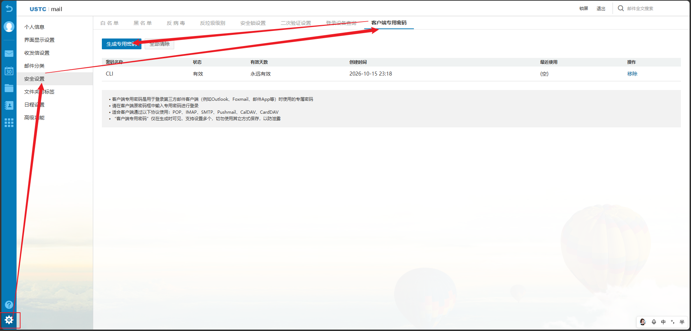

# 使用教程

## 1. 安装

Windows 用户从 [Releases](https://github.com/Zxxx-dev/USTC-MAIL/releases/latest) 下载 `ustc-mail.exe`，放在自己选择的目录。在该目录打开 PowerShell，通过 `.\ustc-mail.exe` 运行，无需安装 Python。当前提供 Windows x64 版本。

Python 用户需要 Python 3.11+。安装 Git 后运行：

```sh
python -m pip install "git+https://github.com/Zxxx-dev/USTC-MAIL.git"
```

也可以下载 Release 中的 `.whl` 文件后运行 `python -m pip install 文件名.whl`，无需 Git；或下载源码压缩包、解压并在源码目录执行 `python -m pip install .`。Windows 依赖 `pywin32`，安装 Python 版时自动包含。

下文使用 Python 版的 `ustc-mail` 命令；EXE 用户将它替换为 `.\ustc-mail.exe`。全局参数 `--account` 放在子命令之前；也可设置 `USTC_MAIL_ACCOUNT`，命令参数优先。没有默认个人账号。

## 2. 获取客户端专用密码

1. 登录[科大邮箱网页版](https://mail.ustc.edu.cn/)。
2. 点击左下角齿轮，进入“安全设置”。
3. 打开“客户端专用密码”，点击“生成专用密码”。
4. 按网页提示完成验证，在本地终端隐藏输入生成的密码。



密码仅生成时可见；不要把密码贴给 Agent、写入聊天、邮件 JSON 或仓库。服务配置参见[官方邮箱帮助](https://mail.ustc.edu.cn/coremail/help/index.jsp)：`mail.ustc.edu.cn`，IMAP TLS 993、SMTP TLS 465，登录名使用完整邮箱地址。

Windows 初始化与管理：

```sh
ustc-mail --account user@mail.ustc.edu.cn auth login
ustc-mail --account user@mail.ustc.edu.cn auth status
ustc-mail --account user@mail.ustc.edu.cn auth forget
```

`auth login` 隐藏输入客户端专用密码，先验证 SMTP 登录，成功后保存到当前 Windows 用户的凭据管理器，不发送邮件。`auth status` 输出保存状态，不显示密码。`auth forget` 移除本机凭据，不撤销服务器密码，仅在需要移除时运行。

其他系统使用联网命令时隐藏输入密码；自动化环境也可临时注入 `USTC_MAIL_PASSWORD`。读取顺序为临时环境变量、当前账号的 Windows 凭据、交互输入。环境变量若过期会覆盖有效保存凭据；排障只检查是否存在，不输出值。非 Windows 系统不支持 `auth login/forget` 保存或删除凭据。

## 3. 查看邮件

```sh
ustc-mail --account user@mail.ustc.edu.cn folders
ustc-mail --account user@mail.ustc.edu.cn list --limit 10
ustc-mail --account user@mail.ustc.edu.cn read 123 --folder INBOX
```

`123` 是 `list` 输出的 UID，仅在对应文件夹内有效。读取使用只读选择和 `BODY.PEEK`，不主动改变已读状态。`folders` 返回实际文件夹编码名和特殊用途标志；草稿箱依据 `\Drafts` 标志识别，中文名称可能是 IMAP 修改版 UTF-7，不猜测英文名称。

## 4. 准备、预览、保存草稿

自行创建 `mail.json` 与 UTF-8 正文文件 `body.txt`：

```json
{
  "to": "recipient@example.com",
  "cc": [],
  "subject": "邮件主题",
  "body_file": "body.txt",
  "attachments": []
}
```

可选 `html_file` 指向实际发送的 HTML 正文片段，不能直接使用含导航和操作按钮的整页 HTML；`attachments` 填文件路径数组。路径相对 JSON 所在目录，也支持绝对路径。仅支持一个主收件人和可选抄送，不支持密送、群发或自动追信。

```sh
ustc-mail --account user@mail.ustc.edu.cn preview mail.json --output preview.html
ustc-mail --account user@mail.ustc.edu.cn draft mail.json --folder Drafts
```

预览不联网，输出正文、附件信息和 SHA-256；已有 HTML 文件不覆盖。草稿箱名替换为 `folders` 实际返回值。草稿新增后按 Message-ID 定位并回读完整 MIME；失败或内容不一致时可能已保存，先人工检查，避免重复新增。

## 5. 逐封确认发送

操作员核对具体收件人、主题、正文、附件并授权后运行：

```sh
ustc-mail --account user@mail.ustc.edu.cn send mail.json --confirm-sha256 "预览输出的完整64位指纹"
```

指纹覆盖收发件地址、抄送、主题、双格式正文及附件名称/内容；内容修改后必须重新预览。Agent 能计算指纹不代表已经获得发送授权。工具不自动发送或重试。

发送记录位于用户主目录的 `.ustc-mail/receipts/`。同内容已有记录时阻止再次发送；记录包含地址、主题、Message-ID、时间和状态，不含密码或正文：

| 状态 | 含义 |
|---|---|
| `attempting` | 已开始提交，最终结果未知，先查邮箱和记录 |
| `smtp_accepted` | SMTP 接受所有收件人，不证明对方已收到或已读 |
| `partially_refused` | 部分地址拒收，其他地址可能已接受，不可整封重发 |

去重只覆盖本 CLI 的本地记录，不能识别其他客户端历史发送；不要自动删除记录来绕过去重。工具不自动追加“已发送”副本，服务器归档行为须自行核验。
